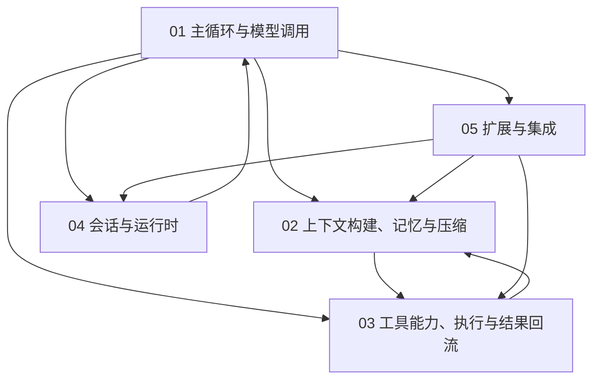
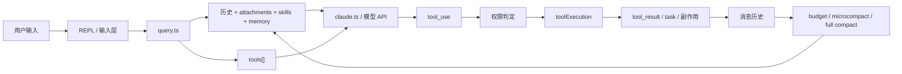
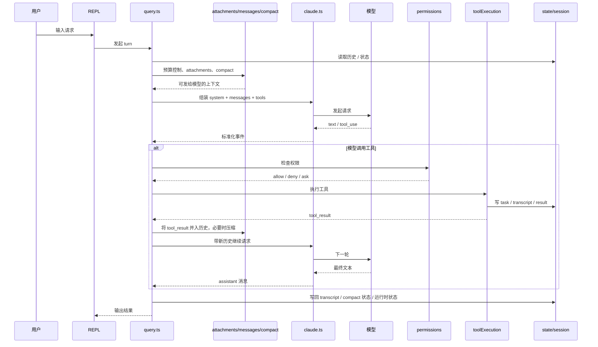

# Claude Code 架构总览

这组文档按“总览 + 模块拆分”的方式整理当前仓库的实现结构，重点回答三件事：

- 主要模块分别有哪些文件
- 这些模块之间怎么交互
- 一次完整请求是怎么在系统里流转的

这不是重构提案，只描述当前仓库里的真实实现。

## 先看边界原则

这套文档的模块划分是按“主责任”做的，不是按“是否完全独立”做的。

尤其要先明确三点：

1. `query.ts` 是总编排器，所以天然会跨很多模块
2. `tool` 不只是执行层，它还会以 `tools[]` 和 `tool_result` 两种形态参与模型上下文
3. `compact` 不只是上下文层逻辑，它必须理解 tool result 的语义，所以和工具执行链是重耦合的

也就是说：

- 从静态职责看，`tool` 和 `context` 可以拆开讲
- 从运行时链路看，二者通过 `tool_result -> compact -> 下一轮上下文` 深度耦合

## 阅读顺序

建议按下面顺序阅读：

1. [主循环与模型调用](./01-主循环与模型调用.md)
2. [上下文构建、记忆与压缩](./02-上下文构建、记忆与压缩.md)
3. [工具能力、执行与结果回流](./03-工具能力、执行与结果回流.md)
4. [会话与运行时](./04-会话与运行时.md)
5. [扩展与集成](./05-扩展与集成.md)
6. [真实调用链与关键耦合点](./06-真实调用链与关键耦合点.md)

## 两种理解视角

### 1. 静态职责视角

这个视角回答的是：

- 每块代码主要负责什么
- 入口文件在哪里
- 哪些模块是编排中心，哪些是能力模块，哪些是基础运行时

### 2. 运行时信息流视角

这个视角回答的是：

- 一轮请求怎样闭环
- 为什么 tool 和 context 不能简单看成两块互不相干的层
- 为什么 compact 一定要理解 tool result

## 模块划分

### 1. 主循环与模型调用

对应文档：[主循环与模型调用](./01-主循环与模型调用.md)

包含：

- `query.ts` 主循环
- 模型请求构造
- system prompt 组装
- 流式响应处理
- tool call 递归推进

### 2. 上下文构建、记忆与压缩

对应文档：[上下文构建、记忆与压缩](./02-上下文构建、记忆与压缩.md)

包含：

- attachments
- messages 标准化
- skills 进入上下文的路径
- memory
- tool result budget
- microcompact / full compact

### 3. 工具能力、执行与结果回流

对应文档：[工具能力、执行与结果回流](./03-工具能力、执行与结果回流.md)

包含：

- Tool 定义与注册
- tool schema 进入模型
- 权限判定
- 工具执行
- task / subagent
- tool result 回写历史

### 4. 会话与运行时

对应文档：[会话与运行时](./04-会话与运行时.md)

包含：

- 启动与 REPL 装配
- AppState / session
- 会话恢复
- 远程会话 / 直连
- Team / Swarm
- UI、输入系统、快捷键

### 5. 扩展与集成

对应文档：[扩展与集成](./05-扩展与集成.md)

包含：

- MCP
- 插件与命令
- IDE / LSP
- 配置与迁移
- 通知与推荐
- 语音和浏览器桥接

### 6. 真实调用链与关键耦合点

对应文档：[真实调用链与关键耦合点](./06-真实调用链与关键耦合点.md)

包含：

- 关键函数级调用链
- tool result 如何回流成上下文
- session recovery 如何恢复 skill 状态
- session memory 和 extract memories 的差异
- 运行时最重的几个耦合点

## 一次 turn 的完整时序

## 最短结论

如果只保留最重要的理解框架，这个仓库可以概括成：

- `query.ts` 是总编排器
- `claude.ts` 是模型适配器
- `attachments + messages + compact` 组成上下文系统
- `tools + permissions + toolExecution + tasks` 组成能力执行系统
- `tool result` 是上下文系统和执行系统最重要的耦合点
- `state/session` 把消息、任务、恢复、远程和扩展状态挂到同一棵运行时状态树上

理解这套架构时最容易误解的一点是：

- `tool` 不只是 `tools[]`
- `compact` 不只是摘要
- `attachment` 不只是补充说明

这三者一起决定了“模型下一轮到底能看到什么”。
