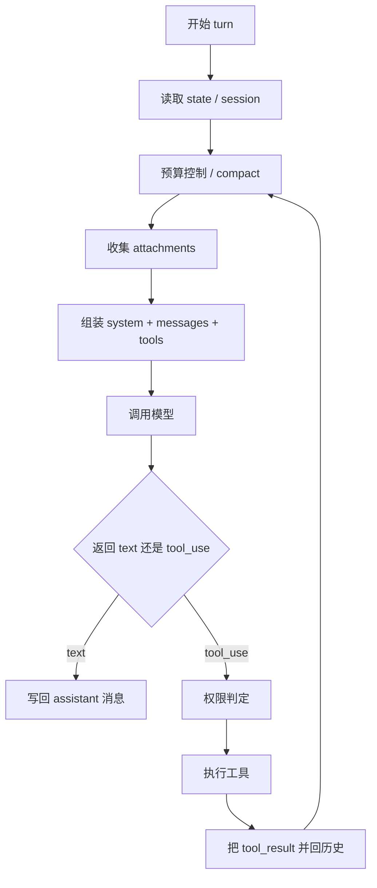

# 主循环与模型调用

这一层回答两个问题：

- 一次 turn 是怎么被编排起来的
- 模型请求是怎么从仓库内部状态编译出来的

它的核心不是“拥有所有上下文逻辑”，而是“把上下文、工具、状态、扩展装配成一次可执行的模型回合”。

## 1. 文件拆分

### 1.1 主循环

- `src/query.ts`

### 1.2 模型适配

- `src/services/api/claude.ts`
- `src/services/api/client.ts`

### 1.3 system prompt 与规则拼装

- `src/constants/prompts.ts`

## 2. 主循环在做什么

`src/query.ts` 是整个系统的编排中心。单次 turn 里，它会依次处理：

1. 从 session/state 取历史
2. 取 compact boundary 之后的消息
3. 先做 tool result budget、snip、microcompact、context collapse、autocompact
4. 收集 attachments，生成 meta messages
5. 组装 `system + messages + tools`
6. 调模型
7. 解析流式输出
8. 如遇 `tool_use`，交给权限与工具执行链
9. 把 tool result 并回历史
10. 必要时继续递归下一轮

它之所以“显得很厚”，不是因为所有逻辑都属于它，而是因为它天然处于所有主链的交汇点。

## 3. 模型适配层在做什么

`src/services/api/claude.ts` 的职责更接近“协议编译器”。

它主要负责：

- 选择 provider client
- 判断是否开启 tool search
- 过滤 `filteredTools`
- 调 `toolToAPISchema(...)` 生成 API `tools[]`
- 规范化消息
- 组装系统提示和缓存相关字段
- 处理流式响应

这里要注意一个边界：

- `claude.ts` 负责把工具写进请求
- 但不负责真正执行工具

## 4. system prompt 在这里的位置

`src/constants/prompts.ts` 负责全局规则的拼装，例如：

- 系统行为规则
- tool result 提醒
- compact 相关提醒
- skill / command 的使用规则

它属于“模型输入”的一部分，但不是完整上下文；真正的大量动态上下文仍然来自 attachment 和消息历史。

## 5. 为什么这一层高耦合但仍然可以拆讲

这一层高耦合的原因是：

- 它必须知道上下文什么时候够、什么时候要 compact
- 它必须知道工具什么时候可以被调用
- 它必须知道 session/runtime 当前处于什么状态

但它仍然可以和其他模块拆讲，因为它主要负责的是“编排顺序”，而不是每个子系统的内部细节。

更准确地说：

- 它对上下文模块是“调用方”
- 对工具模块是“调度方”
- 对状态模块是“读写方”
- 对扩展模块是“装配方”

## 6. 这一层与其他模块的交互

### 6.1 与上下文构建、记忆与压缩

- 从那里取 attachment 和消息标准化结果
- 在调用模型前执行 compact 链
- 在工具返回后再次把结果并入上下文

### 6.2 与工具能力、执行与结果回流

- 从工具模块获取工具池
- 接收模型返回的 `tool_use`
- 把执行权限和执行过程下发给工具模块
- 把 tool result 收回来继续下一轮

### 6.3 与会话与运行时

- 从 state/session 取历史、任务和恢复状态
- 把新的 assistant 消息、tool result、compact 状态写回去

### 6.4 与扩展与集成

- MCP、plugin、IDE、LSP、外部输入都会以“工具”或“上下文”的方式被装进本层的回合组装中

## 7. 主循环视角下的一次回合

## 8. 一句话总结

这一层的核心不是“拥有上下文”或“拥有工具”，而是：

- 决定一轮里先做什么、后做什么
- 决定哪些系统在这一轮被调用
- 决定什么时候继续递归、什么时候结束回复
