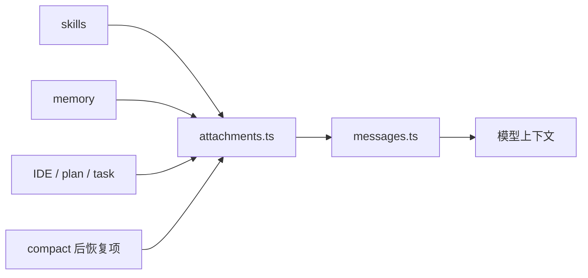
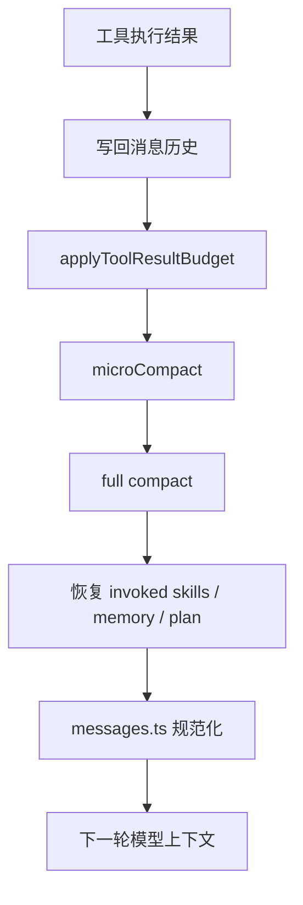

# 上下文构建、记忆与压缩

这一层负责回答：

- 模型当前到底能看到什么
- 这些信息是怎么从仓库状态、skill、memory、tool result 变成消息上下文的
- 当上下文太长时，哪些东西会被删、哪些必须保留

这层和工具模块不是弱耦合，而是通过 `tool_result -> compact -> 下一轮上下文` 形成重耦合。

## 1. 文件拆分

### 1.1 attachments 与消息标准化

- `src/utils/attachments.ts`
- `src/utils/messages.ts`

### 1.2 skills 作为上下文来源

- `src/commands.ts`
- `src/skills/loadSkillsDir.ts`
- `src/tools/SkillTool/SkillTool.ts`

### 1.3 memory

- `src/services/SessionMemory/sessionMemory.ts`
- `src/services/SessionMemory/sessionMemoryUtils.ts`
- `src/services/SessionMemory/prompts.ts`
- `src/services/extractMemories/extractMemories.ts`
- `src/services/extractMemories/prompts.ts`
- `src/memdir/`

### 1.4 tool result 存储与预算控制

- `src/utils/toolResultStorage.ts`

### 1.5 compact

- `src/services/compact/autoCompact.ts`
- `src/services/compact/compact.ts`
- `src/services/compact/microCompact.ts`
- `src/services/compact/postCompactCleanup.ts`
- `src/services/compact/sessionMemoryCompact.ts`

### 1.6 需要被 compact 保住的状态

- `src/bootstrap/state.ts`

## 2. 这层不是只有 prompt

当前仓库里，进入模型上下文的内容至少来自四类来源：

1. 历史消息
2. attachments
3. compact 之后保留下来的摘要与恢复信息
4. tool result 并回历史后的消息块

所以“上下文”不是某一个字符串，而是一整套动态构造的消息集合。

## 3. attachments 在做什么

`src/utils/attachments.ts` 是上下文汇聚器。

它会收集：

- skill listing / skill discovery
- relevant memories / nested memory
- current session memory
- plan / todo / task 提醒
- IDE 选区和其他外部上下文
- compact 后需要重新挂回的信息

随后由 `src/utils/messages.ts` 把这些 attachment 变成 meta user messages。

## 4. skills 为什么属于上下文来源

skill 在大多数时候不是工具调用，而是上下文提示。

它进入模型的典型路径有三条：

1. `system prompt` 里只给使用规则
2. `skill_listing / skill_discovery` 作为 attachment 注入
3. 真正调用 `SkillTool` 后，把 skill 正文作为 meta user message 注入

其中第 3 条尤其关键，因为它说明：

- `SkillTool` 是工具模块里的实现
- 但它的输出形式是上下文消息

这就是工具层和上下文层重叠的一个典型例子。

## 5. memory 是怎么进入当前轮的

memory 主要不是通过 tool 暴露给模型，而是先被选出来，再变成 attachment。

它的典型形态包括：

- relevant memories
- nested memory
- current session memory
- 某些 memory 文件内容

因此 memory 更像“上下文来源”，不是“可执行能力”。

## 6. compact 为什么不只是摘要

compact 不是简单地把旧对话总结成一段文字，它实际是一个分层流程：

1. `applyToolResultBudget`
   先把过大的 tool result 做替换或裁剪
2. `microCompact`
   优先清理旧工具结果，而不是直接总结整个对话
3. `compact.ts`
   真正做 full compact / summarize
4. `postCompactCleanup`
   compact 后做恢复和收尾

所以 compact 的核心不是“写摘要”，而是：

- 删掉可重建的大块内容
- 保住不可重建的关键语义

## 7. 为什么这一层和工具模块重耦合

因为本仓库里最昂贵、最容易爆上下文、同时又最关键的信息，往往来自 tool result。

典型包括：

- FileRead 结果
- Bash 输出
- 搜索结果
- Agent / task 结果
- SkillTool 注入的正文

compact 要正确工作，就必须理解：

- 哪些消息是 tool result
- 哪些 tool result 只是原始输出，可以缩
- 哪些 tool result 实际上承载了后续推理必须保留的语义

这意味着：

- 静态职责上，compact 在上下文模块
- 运行时依赖上，compact 深度依赖工具执行链

## 8. invoked skills 为什么单独值得提

`src/bootstrap/state.ts` 里有 `addInvokedSkill(...)`。

这套状态的意义是：

- skill 一旦真正被调用并注入正文
- compact 之后不能把它完全丢掉
- 系统需要按 `agentId` 记住哪些 skill 已经被调用过

所以 skill 在这里也不是一次性文本，而是会进入可恢复的上下文状态。

## 9. 从 tool result 到下一轮上下文

这条链就是为什么不能把“工具执行”和“上下文构建”看成两块完全独立的系统。

## 10. 这一层与其他模块的交互

### 10.1 与主循环与模型调用

- 被 `query.ts` 在每轮里主动调用
- 产出最终可发给模型的上下文

### 10.2 与工具能力、执行与结果回流

- 读取工具结果
- 对工具结果做预算控制和 compact
- 保留执行痕迹进入下一轮

### 10.3 与会话与运行时

- 从 state/session 读取完整历史
- 将 compact state、invoked skill 状态等持久化

### 10.4 与扩展与集成

- MCP prompt、IDE 选区、外部输入都可以成为 attachment 来源

## 11. 一句话总结

这一层真正负责的是：

- 决定模型“看到什么”
- 决定过长历史“保留什么”
- 决定工具执行之后“哪些痕迹要继续留在上下文里”
