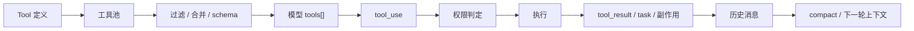

# 工具能力、执行与结果回流

这一层负责把“模型产生的行动意图”变成“系统里的真实动作”，同时把动作结果重新送回会话。

如果只看静态结构，它是能力执行层；  
如果看运行时闭环，它又是上下文系统的上游生产者。

## 1. 文件拆分

### 1.1 工具定义与注册

- `src/Tool.ts`
- `src/tools.ts`
- `src/utils/api.ts`

### 1.2 工具编排与执行

- `src/services/tools/toolOrchestration.ts`
- `src/services/tools/toolExecution.ts`

### 1.3 权限

- `src/hooks/useCanUseTool.tsx`
- `src/hooks/toolPermission/`
- `src/utils/permissions/`
- `src/components/permissions/`

### 1.4 任务与子代理

- `src/Task.ts`
- `src/tasks/types.ts`
- `src/tasks/LocalShellTask/`
- `src/tasks/LocalAgentTask/`
- `src/tasks/RemoteAgentTask/`
- `src/utils/forkedAgent.ts`
- `src/tools/AgentTool/`

### 1.5 典型工具

- `src/tools/BashTool/`
- `src/tools/FileReadTool/`
- `src/tools/SkillTool/`
- `src/tools/AgentTool/`

### 1.6 执行后端

- `src/utils/fsOperations.ts`
- `src/utils/Shell.ts`

## 2. 这一层的三段式结构

### 2.1 能力定义

由 `Tool.ts` 和具体 tool 文件定义：

- 名称
- prompt / description
- input schema
- 只读/可变更语义
- 权限语义

### 2.2 能力暴露

由 `tools.ts` 和 `utils/api.ts` 负责：

- 构建工具池
- 合并 built-in 和 MCP tools
- 根据权限和模式过滤
- 转成模型 API `tools[]`

### 2.3 能力执行

由 `toolExecution.ts`、`toolOrchestration.ts` 和具体 executor 负责：

- 接收 `tool_use`
- 判权限
- 真执行
- 产出 `tool_result`
- 把结果写回 transcript / task / 状态

## 3. 一个 tool 的完整生命周期

这里最关键的是最后两步：

- 工具执行结束并不意味着它“完成了”
- 它的结果还会继续影响下一轮上下文

## 4. 为什么 tool 不能只算执行层

因为在这个仓库里，tool 同时有三种存在形态：

1. `tool schema`
   模型在请求里看到“可以做什么”
2. `tool execution`
   系统真实去做事
3. `tool result`
   执行结果重新进入消息历史，成为后续上下文的一部分

所以更准确的说法是：

- tool 的“能力定义和执行”属于本层
- tool 的“上下文痕迹”会流入上下文构建与压缩模块

## 5. 权限为什么放在这里

权限不是单独的产品细节，而是工具执行链的核心组成部分。

顺序是：

1. 模型输出 `tool_use`
2. 权限层给出 `allow / deny / ask`
3. 工具执行层据此决定是否真的落地

它的作用是把：

- 模型的建议
- 系统的副作用

明确隔开。

## 6. task 和 subagent 为什么归在这层

因为它们本质上是“某种工具执行形态”。

例如：

- BashTool 可以提升成后台 shell task
- AgentTool 可以提升成 local/remote/in-process subagent task

也就是说：

- tool 是能力入口
- task/subagent 是执行承载体

## 7. `ToolUseContext` 是真正的跨层载体

从代码结构看，`ToolUseContext` 是这个系统里很重要的共享上下文对象。

它会携带：

- 当前工具集
- 权限上下文
- query tracking
- dynamic skill / memory 触发信息
- 其他执行和上下文相关状态

这也是为什么工具层和上下文层在运行时会绑得很紧。

## 8. SkillTool 为什么是跨界工具

`SkillTool` 是理解边界最好的例子：

- 从能力定义看，它是一个 tool
- 从执行结果看，它产出的是一条 meta user message
- 从 compact 看，它还要通过 `addInvokedSkill(...)` 进入保留状态

所以 SkillTool 同时踩在：

- 工具系统
- 上下文系统
- compact 恢复系统

三条链上。

## 9. 这一层与其他模块的交互

### 9.1 与主循环与模型调用

- 提供 `tools[]`
- 接收 `tool_use`
- 返回 `tool_result`

### 9.2 与上下文构建、记忆与压缩

- 工具结果会写回历史
- 历史中的旧工具结果会被 budget / compact
- 关键工具结果会间接影响 memory 和后续推理

### 9.3 与会话与运行时

- 长任务需要 task 面板和状态树承接
- subagent 需要独立上下文和恢复支持

### 9.4 与扩展与集成

- MCP tools 会并入工具池
- 插件和 IDE/LSP 会影响工具可用性和推荐

## 10. 一句话总结

这一层真正负责的是：

- 决定系统“能做什么”
- 决定模型的动作“能不能做”
- 决定做完之后“结果如何回到会话里”
