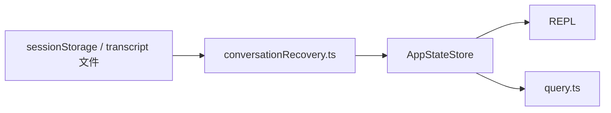

# 会话与运行时

这一层负责把“单次模型调用”托管成一个持续存在的产品会话。

它关心的不是某一个 prompt，也不是某一个 tool，而是：

- 会话怎么启动
- 状态怎么存
- 任务怎么展示
- 会话怎么恢复
- 远程和协作能力怎么挂进来

## 1. 文件拆分

### 1.1 启动与 REPL

- `src/main.tsx`
- `src/screens/REPL.tsx`

### 1.2 状态与会话

- `src/state/AppStateStore.ts`
- `src/state/store.ts`
- `src/utils/sessionStorage.ts`
- `src/utils/sessionStoragePortable.ts`
- `src/utils/conversationRecovery.ts`

### 1.3 远程会话与直连

- `src/remote/RemoteSessionManager.ts`
- `src/remote/SessionsWebSocket.ts`
- `src/server/createDirectConnectSession.ts`
- `src/server/directConnectManager.ts`
- `src/hooks/useRemoteSession.ts`
- `src/hooks/useReplBridge.tsx`
- `src/hooks/useDirectConnect.ts`
- `src/hooks/useTeleportResume.tsx`

### 1.4 Team / Swarm

- `src/utils/swarm/`
- `src/hooks/useSwarmInitialization.ts`
- `src/hooks/useSwarmPermissionPoller.ts`
- `src/components/teams/TeamsDialog.tsx`
- `src/components/teams/TeamStatus.tsx`

### 1.5 UI、输入与快捷键

- `src/ink/`
- `src/hooks/useTextInput.ts`
- `src/hooks/useSearchInput.ts`
- `src/hooks/useVimInput.ts`
- `src/hooks/useGlobalKeybindings.tsx`
- `src/keybindings/`
- `src/components/tasks/`
- `src/components/shell/`
- `src/components/skills/SkillsMenu.tsx`

## 2. 启动和 REPL 的分工

### 2.1 `main.tsx`

负责：

- 初始化环境
- 读取配置
- 做启动期装配
- 把依赖和状态挂进 REPL

### 2.2 `REPL.tsx`

负责：

- 输入交互
- 消息展示
- 任务面板
- 权限确认
- 通知状态
- 插件、MCP、远程状态的 UI 承接

## 3. `AppStateStore` 为什么是运行时中心

`AppStateStore` 不是一个简单的 UI store，它实际上承接了大量长期状态：

- transcript
- tasks
- MCP clients / tools / commands / resources
- notifications
- permission context
- file history
- plugins
- agents

所以这层不是纯展示层，而是运行时的状态底座。

## 4. 会话恢复怎么串起来

恢复时不仅是把消息读回来，还要考虑：

- compact boundary
- task 状态
- agent transcript
- remote / teleported session 状态

## 5. 远程会话为什么属于运行时层

远程会话不是新的模型能力，而是新的会话承载方式。

它解决的是：

- 会话如何桥接
- 会话如何被远程接入
- 会话如何恢复和直连

因此它主要影响：

- session/state
- REPL 交互
- 任务和恢复逻辑

## 6. Team / Swarm 为什么更像运行时扩展

swarm 当然会调用 subagent，但它不是单纯的工具实现。

它还包括：

- 队友生命周期
- 权限同步
- mailbox / leader bridge
- 协作 UI

所以它更适合作为运行时系统的一部分来理解。

## 7. UI、输入和快捷键为什么单独成簇

这个仓库不只是“用一个现成终端 UI 框架”，而是自己维护了一层：

- 终端渲染
- 输入管理
- 搜索输入
- Vim 模式
- 快捷键系统

这层决定了：

- 用户输入如何进入主循环
- 运行时状态如何被展示
- 工具、任务、远程会话如何被观察和控制

## 8. 这一层与其他模块的交互

### 8.1 与主循环与模型调用

- 发起 turn
- 提供历史和运行态
- 展示输出结果

### 8.2 与上下文构建、记忆与压缩

- 会话历史和恢复信息是上下文构建的基础
- compact 结果也需要落回 session/state

### 8.3 与工具能力、执行与结果回流

- task 和 shell 输出由运行时展示
- 权限确认由运行时承接

### 8.4 与扩展与集成

- MCP、LSP、通知、远程设置等最终都要挂回运行时状态树

## 9. 一句话总结

这一层真正负责的是：

- 让系统不是“一次性调用”，而是“可持续运行、可恢复、可观察的会话”
