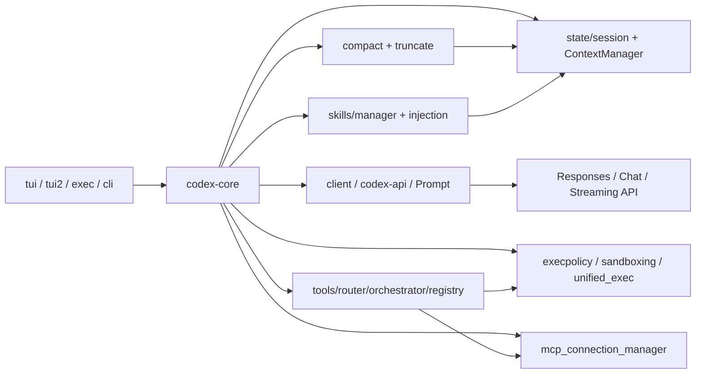
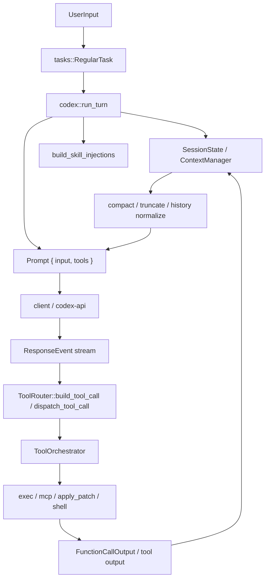

# Codex Rust 架构总览

这份文档基于 `/home/liufeng/Code/self/codex/codex-rs` 当前代码整理，结构和前面的 Claude Code 架构文档保持同口径，重点回答：

- `codex-rs` 的主模块分别有哪些文件
- 一次 turn 是怎么流转的
- 它和 Claude Code 在架构上有哪些同构点，哪些地方明显不同

## 阅读顺序

建议按下面顺序阅读：

1. [主循环与模型调用](./01-主循环与模型调用.md)
2. [上下文构建、记忆与压缩](./02-上下文构建、记忆与压缩.md)
3. [工具能力、执行与结果回流](./03-工具能力、执行与结果回流.md)
4. [会话与运行时](./04-会话与运行时.md)
5. [扩展与集成](./05-扩展与集成.md)
6. [真实调用链与关键耦合点](./06-真实调用链与关键耦合点.md)
7. [Claude Code 与 Codex Rust 架构对比](../Claude-Code-与-Codex-Rust-架构对比.md)

## 总体判断

`codex-rs` 和 Claude Code 在“产品能力”层面有很多相同概念：

- agent 主循环
- 模型调用
- tools
- skills
- session/history
- compact
- MCP
- sandbox / approvals

但它们的落点明显不同：

- Claude Code 更像“REPL 产品外壳 + agent runtime”长在一起
- Codex Rust 更像“`core` 先做成可复用库，再由 `tui/exec/cli` 挂不同前端”

## 顶层结构

从 `/home/liufeng/Code/self/codex/codex-rs/README.md` 和 workspace 目录看，最重要的 crate 是：

- `core/`
  核心业务逻辑库
- `exec/`
  非交互 / headless CLI
- `tui/`
  第一版 Ratatui 交互前端
- `tui2/`
  第二版 TUI 前端
- `cli/`
  多工具入口，负责子命令分发
- `exec-server/`
  执行服务 / MCP server / execve wrapper
- `codex-api/`
  模型 API 和 SSE/Responses 相关封装
- `codex-client/`
  客户端传输层
- `execpolicy/`, `linux-sandbox/`, `windows-sandbox-rs/`
  执行策略和沙箱基础设施

## 总体结构图

## 一次 turn 的主链

## 和 Claude Code 的第一层差异

最值得先记住的 4 个差异：

1. `codex-rs` 的中心不是一个 REPL 组件，而是 `codex-core`
2. tool 体系是显式的 `ToolRouter + ToolOrchestrator + ToolRegistry`
3. session/history 被收敛进 `ContextManager + SessionState`
4. skill 注入更偏“显式注入 skill 正文”，而不是像 Claude Code 那样强依赖 `skill_listing / skill_discovery attachment`

## 最短结论

如果只用一句话概括：

- Claude Code 更像“产品 REPL 驱动的 agent 系统”
- Codex Rust 更像“核心库驱动、前端可替换的 agent 平台”
