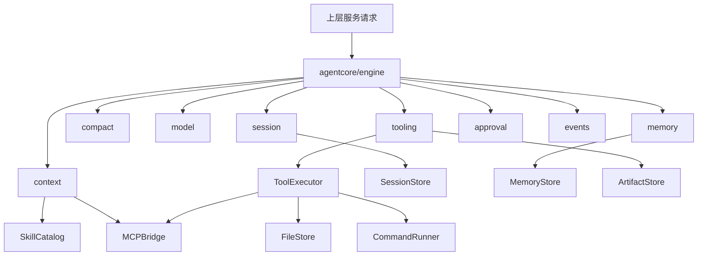

# Go Agent Core 目标架构总览

这份设计文档的目标是定义一套新的 Go 架构，满足下面 4 个约束：

- 语言选型是 Go
- 业务能力向 Claude Code 看齐
- 工程抽象水平向 Codex Rust 看齐
- 不做 CLI/TUI，只提供可嵌入多租户服务的接口和核心库

同时还要满足一个额外要求：

- 核心代码和支持代码分离
  这里的支持代码包括 `skill`、`mcp`、`tool`、`文件系统`、`bash`

## 1. 设计目标

一句话目标：

- 做一个“面向服务端嵌入”的 Go agent core library，业务上具备 Claude Code 的上下文组织、skill、tool、compact、memory 能力，工程边界上采用 Codex Rust 那种 `core-first`、接口清晰、前端可替换的风格。

## 2. 设计原则

### 2.1 业务形态向 Claude Code 看齐

这里指的不是复刻它的 UI，而是复刻这些业务能力：

- 多源上下文注入
- skill 发现与注入
- tool schema 暴露与 tool result 回流
- compact / history shrinking
- session memory / persistent memory
- approvals / sandbox / policy
- MCP 接入
- 可恢复的 session / turn / transcript

### 2.2 工程边界向 Codex Rust 看齐

这里指的是这些工程原则：

- 先有 `core library`，再有外层适配
- `Prompt/Turn/Session` 是核心抽象，不让 UI 反向主导核心逻辑
- `ToolRouter / ToolOrchestrator / SessionState / ContextManager` 这类抽象边界清晰
- 前端、部署形态、传输层都可以替换

### 2.3 核心只依赖接口，不依赖本地实现

最重要的一条：

- `agent-core` 不直接依赖本地文件系统
- `agent-core` 不直接依赖本地 bash
- `agent-core` 不直接依赖 skill 文件目录
- `agent-core` 不直接依赖 MCP 具体 transport

它只依赖这些能力接口：

- `ModelProvider`
- `SessionStore`
- `ContextSource`
- `Compactor`
- `ToolRegistry`
- `ToolExecutor`
- `ApprovalManager`
- `ArtifactStore`
- `SkillCatalog`
- `MCPBridge`
- `FileStore`
- `CommandRunner`

## 3. 目标模块划分

这套架构建议拆成 5 大块：

1. `agentcore`
   真正的核心库，负责 turn loop、context、session、tool orchestration
2. `support`
   支持能力实现，例如本地 skill、文件系统、bash、patch、MCP bridge
3. `storage`
   transcript、artifact、memory、session 持久化实现
4. `transport`
   暴露给服务端或上层应用的接口层，例如 gRPC/HTTP/SDK adapter
5. `policy`
   sandbox、approval、tenant policy、workspace policy

其中：

- `agentcore` 不能 import `support` 里的具体实现
- `support` 可以 import `agentcore` 里的接口定义

## 4. 最推荐的目录形态

如果做成一个 Go monorepo，我建议是：

```text
/pkg/agentcore
/pkg/agentcore/engine
/pkg/agentcore/model
/pkg/agentcore/context
/pkg/agentcore/session
/pkg/agentcore/memory
/pkg/agentcore/compact
/pkg/agentcore/tooling
/pkg/agentcore/approval
/pkg/agentcore/events
/pkg/agentcore/protocol

/pkg/support/skillfs
/pkg/support/mcpbridge
/pkg/support/toolfs
/pkg/support/toolbash
/pkg/support/toolpatch
/pkg/support/toolgit

/pkg/storage/sessionstore
/pkg/storage/artifactstore
/pkg/storage/memorystore

/pkg/serviceapi
```

如果你更想把核心和支持实现隔得更硬，也可以直接拆成多个 module：

- `agentcore`
- `agent-support-skills`
- `agent-support-tools`
- `agent-support-mcp`
- `agent-storage`

## 5. 核心视角下的总体结构



## 6. 和 Claude Code / Codex Rust 的映射关系

### 6.1 从 Claude Code 吸收什么

- `attachment -> context injection` 的业务思路
- skill 不只是静态 prompt，而是上下文来源
- tool result 不只是执行结果，而是后续上下文的一部分
- compact 不是简单总结，而是上下文治理

### 6.2 从 Codex Rust 吸收什么

- `core-first` 的结构
- `Prompt/Session/Task/Router/Orchestrator` 的清晰边界
- 将执行策略、sandbox、approval 放进统一编排层
- 将前端和核心逻辑彻底解耦

## 7. 关键判断

### 7.1 tool 和 context 不能硬拆

虽然模块上会拆成：

- `context`
- `tooling`

但运行时上必须承认它们是重耦合的，因为：

- tool schema 会进入模型输入
- tool result 会进入下一轮上下文
- compact 必须理解 tool result

所以这套设计里不做“tool 和 context 完全独立”的假设，而是通过统一的 `TurnItem` / `ContextRecord` 抽象把它们接起来。

### 7.2 skill 应该是支持模块，不应该内嵌在 core

原因是：

- skill 的来源是文件系统或远程配置
- skill 的加载、扫描、frontmatter 解析都不属于 agent 核心算法
- core 只关心“我拿到了一组 skill injections”

### 7.3 文件系统和 bash 也应该是支持模块

原因是：

- 这两者是 runtime capability，不是 agent 核心抽象
- 你未来可能换成本地实现、容器实现、远程实现、MCP 实现

## 8. 文档索引

这套设计继续拆成两份细化文档：

1. [包结构与接口](./01-包结构与接口.md)
2. [运行时流程与部署](./02-运行时流程与部署.md)
3. [测试策略与开发用 CLI](./03-测试策略与开发用CLI.md)

## 9. 最短结论

这版 Go 架构的核心判断是：

- 业务形态取 Claude Code
- 核心抽象取 Codex Rust
- `agentcore` 只依赖接口
- skill、mcp、tool、fs、bash 全部做成外围支持实现
