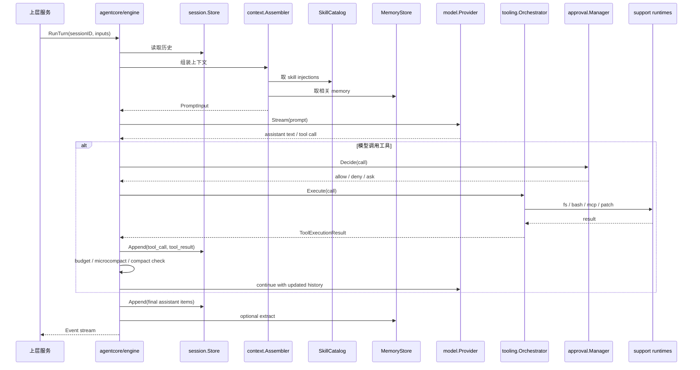

# Go Agent Core 运行时流程与部署

这一份回答两个问题：

- 一次 turn 在系统里怎么流转
- 多租户服务中如何部署这套核心库和支持组件

## 1. 一次 turn 的推荐流程

## 2. 为什么这条链要这么设计

### 2.1 吸收 Claude Code 的地方

- tool result 会重新并回历史
- compact 在每轮模型调用前参与上下文治理
- skill 和 memory 都属于动态上下文来源

### 2.2 吸收 Codex Rust 的地方

- `RunTurn` 还是主循环中心
- 但 `Context / Model / Tooling / Approval / Session` 边界清晰
- 工具执行有独立 orchestrator

## 3. 推荐的数据流形态

建议区分三类对象：

### 3.1 运行时对象

- `TurnRuntime`
- `ExecutionEnv`
- `ApprovalRequest`
- `PromptBuildContext`

这些对象生命周期只在当前 turn 内。

### 3.2 协议对象

- `Prompt`
- `PromptTool`
- `ToolCall`
- `ToolResult`
- `TurnItem`
- `Event`

这些对象负责跨模块传递。

### 3.3 持久化对象

- `Session`
- `SessionMeta`
- `ArtifactRef`
- `MemoryFact`
- `SummaryRecord`

这些对象负责落库。

## 4. tool 和 context 的真实耦合怎么处理

这是整套设计最关键的点。

不要试图在代码里做这种假设：

- tool 是一块
- context 是另一块
- 两者只在模型请求时接触一次

真实情况是：

1. tool schema 先进入模型输入
2. tool execution 发生真实副作用
3. tool result 回到 session history
4. compact 处理 tool result
5. 下一轮 context 又读取 compact 后的 tool result 痕迹

所以正确做法是：

- `tooling` 负责“能力定义 + 执行”
- `context` 负责“上下文装配”
- 二者通过统一 `TurnItem` 历史连接

不要让 `context` 直接依赖某个具体 tool runtime，也不要让 `tooling` 自己维护一套独立 transcript。

## 5. 推荐的部署方式

你说“不需要 CLI，只需要提供接口”，那推荐是三层部署：

### 5.1 核心层

嵌入到你的多租户服务里：

- `agentcore`
- `storage`
- `policy`

这一层负责：

- session/turn
- prompt build
- model call
- approval
- compact
- memory

### 5.2 支持层

和核心同进程或独立进程都可以：

- `skillfs`
- `mcpbridge`
- `toolfs`
- `toolbash`
- `toolpatch`

第一版建议：

- 先同进程实现
- 接口边界先稳定
- 未来需要时再拆进程

### 5.3 本地能力层

如果你仍然坚持本地操作单独跑成 MCP 服务，那么建议：

- `agentcore` 只依赖 `MCPBridge`
- 本地文件、bash、git、patch 统一挂到 `local-workspace-mcp`

这样好处是：

- 核心库完全不碰本地路径和进程
- 未来本地、容器、远端工作机都能共用同一协议边界

## 6. 两种落地模式

### 模式 A：支持模块同进程

适合第一版和单租户内部环境。

优点：

- 简单
- 调试方便
- 延迟低

缺点：

- 边界感不够强
- 本地能力隔离较弱

### 模式 B：支持模块通过 MCP/IPC 独立进程

适合多租户和更强隔离。

优点：

- 边界清晰
- 本地能力可隔离
- 更利于安全控制

缺点：

- 实现复杂度高
- 传输与序列化成本更高

我建议：

- `skillfs` 可以先同进程
- `fs/bash/patch/git` 更适合尽早抽成独立 capability service 或 MCP service

## 7. 最推荐的工程边界

### 7.1 `agentcore` 内部

只保留：

- 主循环
- 协议模型
- 上下文组装
- compact
- memory
- session
- tool orchestration
- approval

### 7.2 `support` 内部

只保留实现：

- skill 文件实现
- MCP client/server 桥
- 文件系统实现
- bash 实现
- patch 实现

### 7.3 `serviceapi`

只负责：

- 对外 HTTP/gRPC
- request/response 映射
- event streaming

不要把业务逻辑塞进 `serviceapi`。

## 8. 第一版范围建议

如果按 MVP 做，我建议第一版只保留：

- session history
- context assembler
- OpenAI Responses provider
- tool registry/router/orchestrator
- approvals
- file/bash/patch 三类支持能力
- 基础 compact
- skill catalog

先不要做：

- 多 agent/swarm
- 复杂 memory extraction agent
- remote session / IDE bridge
- 花哨的推荐和提示系统

## 9. 里程碑建议

### 里程碑 1：能跑通单轮工具回路

- session
- prompt build
- model stream
- tool call
- tool result 回流

### 里程碑 2：能支撑长会话

- compact
- history normalization
- artifact store

### 里程碑 3：能支撑复杂上下文

- skill catalog
- memory
- project docs / AGENTS

### 里程碑 4：能支撑复杂部署

- MCP bridge
- 独立 capability service
- tenant/workspace policy

## 10. 最后的判断

如果按你的目标来取舍，最合理的落点是：

- 业务建模上更接近 Claude Code
- 包结构和接口边界上更接近 Codex Rust
- 本地能力通过 `support` 模块或 MCP service 外挂
- `agentcore` 只做真正稳定的核心算法和运行时编排
